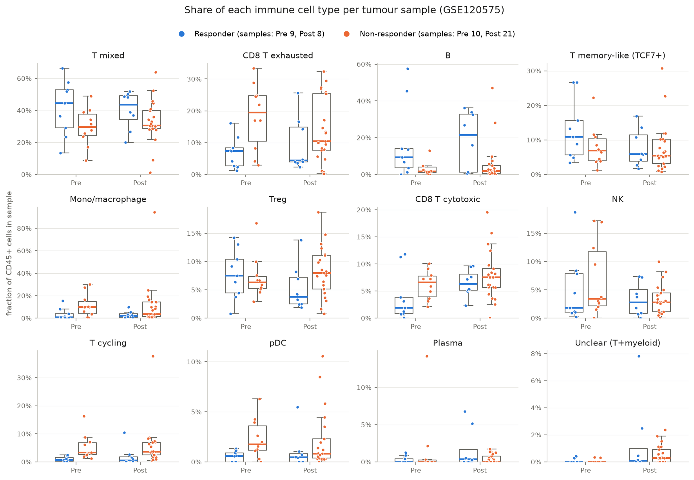
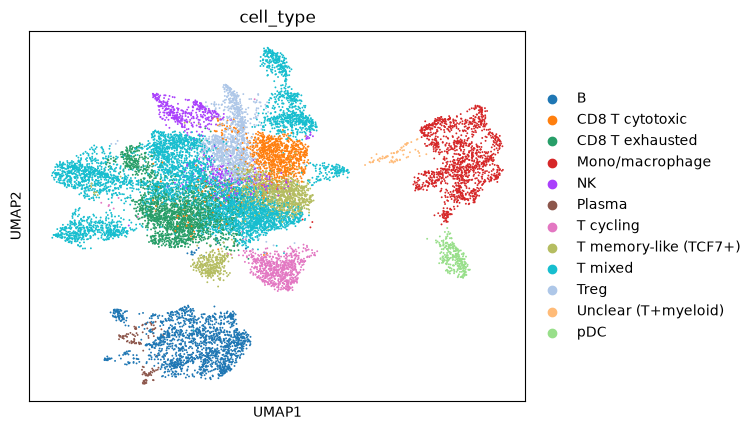

# Immune cell composition and checkpoint response in melanoma (GSE120575)

A minimal, reproducible Scanpy re-analysis of
**Sade-Feldman et al., *Cell* 2018** — "Defining T cell states associated with response to
checkpoint immunotherapy in melanoma" ([PMC6641984](https://pmc.ncbi.nlm.nih.gov/articles/PMC6641984/)).

## Question
Do tumours from patients who respond to checkpoint blockade (anti-PD1 / anti-CTLA4) contain a
different mix of immune cell types than tumours from non-responders, before and during therapy?

## Data
[GEO GSE120575](https://www.ncbi.nlm.nih.gov/geo/query/acc.cgi?acc=GSE120575): Smart-seq2
scRNA-seq of CD45+ cells sorted from 48 melanoma biopsies (32 patients), taken at baseline
(Pre) or on treatment (Post), labelled Responder / Non-responder per biopsy.

| | Pre | Post |
|---|---|---|
| Responder | 9 samples, 2,725 cells | 8 samples, 2,839 cells |
| Non-responder | 10 samples, 3,203 cells | 21 samples, 7,524 cells |

**The GEO matrix is log2(TPM+1), not raw counts.** So there is no `normalize_total` / `log1p`,
and count-based methods (HVG `seurat_v3`, scVI, pseudobulk DESeq2) don't apply.

## Pipeline
| Step | Script | What it does | Notes |
|---|---|---|---|
| 1 | [`01_load.py`](scripts/01_load.py) | GEO matrix + metadata → AnnData | [docs/01](docs/01_load.md) |
| 2 | [`02_qc.py`](scripts/02_qc.py) | Paper's QC: ≥1000 genes, housekeeping ≥2.5, PTPRC or CD3E > 0; genes > 4.5 in ≥10 cells | [docs/02](docs/02_qc.md) |
| 3 | [`03_cluster.py`](scripts/03_cluster.py) | 2,000 HVGs → scale → 50 PCs → kNN (15, 30 PCs) → UMAP + Leiden (res 1.0) | [docs/03](docs/03_cluster.md) |
| 4 | [`04_annotate.py`](scripts/04_annotate.py) | 24 clusters → 12 cell types by canonical markers (rules in code) | [docs/04](docs/04_annotate.md) |
| 5 | [`05_proportions.py`](scripts/05_proportions.py) | Cell-type fraction per sample, R vs NR by timepoint | [docs/05](docs/05_proportions.md) |

`docs/` contains a step-by-step explanation of each choice and its alternatives (in Russian).

## Result


Each dot is one biopsy. In line with the paper:

- Non-responders have more **exhausted CD8 T cells** (Pre: median 20% vs 7%, Mann–Whitney p = 0.013) and more **cycling T cells**.
- Responders have more **B cells** and somewhat more **TCF7+ memory-like T cells**.

Per-sample fractions and test results are in [`results/`](results/).



## Limitations
- **Small n:** 8–21 samples per group. The p-values are unadjusted across 24 tests; after Bonferroni only "T cycling, Pre" survives. Treat the result as descriptive.
- **Non-independence:** some patients contribute several biopsies, and response is labelled per biopsy, so a patient can carry both labels. A mixed model with a patient random effect would be stricter.
- **Mixed therapies:** anti-PD1, anti-CTLA4 and the combination are pooled.
- **Annotation is cluster-level and manual.** 5,599 cells stay "T mixed" (CD4/CD8 not resolved). T-cell subclustering, as in the paper, would split CD8 states further.
- **QC is approximate:** the paper's housekeeping gene list isn't published, and its gene filter was per-sample and protein-coding only. 101 cells (0.6%) of the published matrix fail the literal rules and were removed.
- **Compositional data:** fractions within a sample are dependent. Methods like scCODA or propeller would model this properly.
- **No batch correction:** T cells mix well across patients; some myeloid clusters are patient-specific.

## Reproduce
Data files are not in the repo. Download them into `data/`:
```bash
mkdir data && cd data
curl -O https://ftp.ncbi.nlm.nih.gov/geo/series/GSE120nnn/GSE120575/suppl/GSE120575_Sade_Feldman_melanoma_single_cells_TPM_GEO.txt.gz
curl -O https://ftp.ncbi.nlm.nih.gov/geo/series/GSE120nnn/GSE120575/suppl/GSE120575_patient_ID_single_cells.txt.gz
```
Create the environment and run all steps:
```bash
conda env create -f environment.yml
conda activate scanpy
for s in 01_load 02_qc 03_cluster 04_annotate 05_proportions; do python scripts/$s.py; done
```
On Windows, use `.\run_all.ps1` (it runs each step via `conda run`). Steps 3–4 use `random_state=0`.
